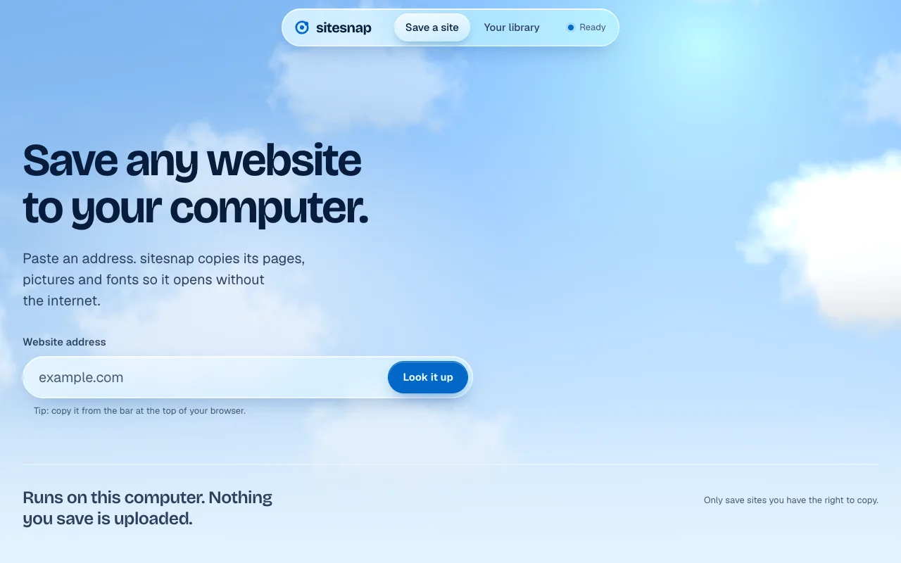
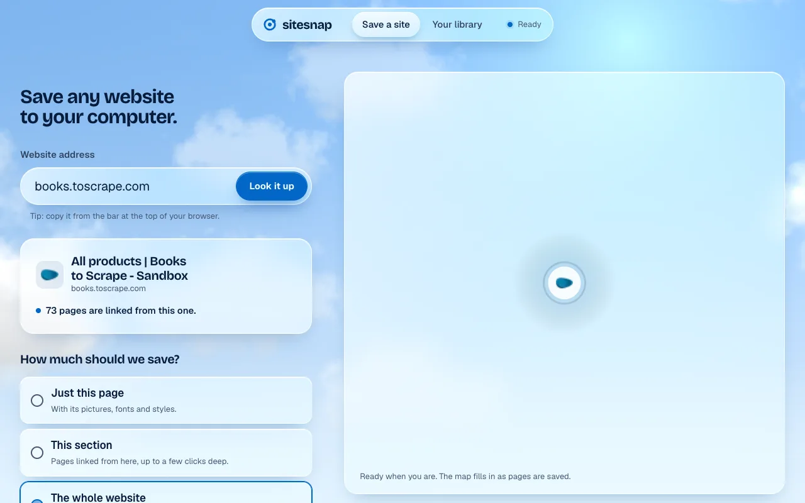

<div align="center">


# sitesnap

**Save any website to your computer, so it opens without the internet.**

Paste an address, choose how much to save, and get a copy you can open any time, even offline.<br />
No account, no coding, nothing uploaded.

[Watch the tour](#watch-the-2-minute-tour) · [Install it](#install-it) · [What it can save](#what-it-can-save) · [Full details](brief.md)

</div>

## Watch the 2-minute tour

VIDEO_URL

<p align="center"><sub>Every feature in 2 minutes 29 seconds. Music: Sascha Ende, ende.app (CC BY 4.0).</sub></p>

## What it does

sitesnap makes a copy of a website on your own computer: its pages, pictures, fonts and styles. The copy opens without the internet, and the links between its pages still work. Think of "Save as PDF", but for a whole website.

**Good for:**

- **Keeping a site before it changes or closes.** A redesign, a business winding down, hosting about to lapse.
- **Reading without internet.** Flights, classrooms, field work.
- **Handing a site to someone.** A client gets a folder they can open by double-clicking.
- **Your own records.** What a page said on a given day.

## How it works

<table>
  <tr>
    <td width="50%" valign="top">
      
      <p align="center"><b>1. Paste an address.</b><br />sitesnap looks the site up first and warns you about anything that would spoil the copy.</p>
    </td>
    <td width="50%" valign="top">
      
      <p align="center"><b>2. Choose how much.</b><br />Just the page, a section, or the whole website.</p>
    </td>
  </tr>
  <tr>
    <td width="50%" valign="top">
      
      <p align="center"><b>3. Watch it save.</b><br />Every dot on the map is a page, saved as it arrives.</p>
    </td>
    <td width="50%" valign="top">
      
      <p align="center"><b>4. Open it, zip it, or find it.</b><br />The copy works with the internet unplugged.</p>
    </td>
  </tr>
</table>

<p align="center">
  <br />
  <b>Everything you save stays in Your library</b>, in <code>Documents / sitesnap</code>.
</p>

## Install it

You need a Mac and about five minutes. You type two commands once; after that it's all buttons.

**1. Install Node.js.** Go to [nodejs.org](https://nodejs.org), download the version marked **LTS**, and run the installer. (sitesnap needs version 18 or newer.)

**2. Download sitesnap.** On this page, press the green **Code** button, then **Download ZIP**, and unzip it. If you use Git, this does the same:

```bash
git clone https://github.com/devamparmar009/sitesnap
```

**3. Open a Terminal in that folder.** Open the **Terminal** app, type `cd ` (with a space after it), drag the sitesnap folder into the window, and press Return.

**4. Set it up, then start it.**

```bash
npm install
```

```bash
npm run app
```

Your browser opens on sitesnap. Next time, you only need step 3 and `npm run app`. To close it, press **Quit** on the page.

> Want a double-click app instead? Run `npm run build:app` once. It makes `dist/sitesnap.app`, which you can keep in Applications. On another Mac, open it the first time with right-click, then **Open**.

sitesnap is made and tested on a Mac. Windows and Linux are not tested yet.

## What it can save

| Works out of the box | Needs modern site mode | Won't save |
| --- | --- | --- |
| Blogs, portfolios and small-business sites | Apps built with React, Vue or Angular | Sites behind a "checking your browser" screen |
| WordPress and most other CMS sites | Pictures that only load as you scroll | Pages the site's robot rules ask tools to avoid, unless it's your site or you have permission |
| Documentation sites and wikis | Very slow pages | |
| News and article pages | | |

**Modern site mode** is a switch under **More options**. It's a one-time download of about 150 MB, and saving is slower.

**Pages behind a login?** Press **Sign in first**. A real browser window opens and you sign in there. sitesnap never sees your password.

## Good to know

- **Private.** It runs on your computer. There's no account, no tracking, and nothing you save is uploaded.
- **Polite.** It follows a site's robot rules and slows down when a site asks. It never tries to get past "prove you're human" screens.
- **A copy, not the live site.** Search boxes, contact forms, shopping carts and logins need the real website, so they don't work in the copy. It's not a backup you can restore a site from.
- **Only save what you have the right to copy.** A site's terms and copyright still apply.

## Want the details?

Everything else is in **[brief.md](brief.md)**: every feature in plain words, the More options, what it can and can't save, where it falls short, the command line for developers (`node bin/cli.js https://example.com --zip`), how it works inside, and the security and test notes.

## Licence

Free to read and to run on your own computer for personal use. Copying, changing, hosting it for other people or selling it needs written permission. See [LICENSE](LICENSE).
